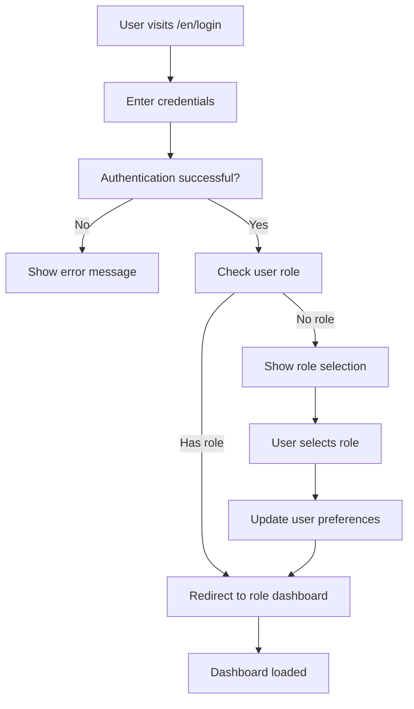

# 🔐 Authentication System - Complete Implementation

## ✅ **Features Implemented**

### 🎯 **Core Authentication**
- **Login/Logout**: Email & password authentication
- **Registration**: Account creation with role selection
- **Password Reset**: Email-based password recovery
- **Session Management**: Automatic session persistence

### 🏷️ **Role-Based Access Control**
- **Three Roles**: Student, Vendor, Admin
- **Automatic Redirection**: Users go directly to their role-specific dashboard
- **Role Selection**: Only shown for new users without assigned roles
- **Protected Routes**: Dashboard pages restricted by role

### 🌍 **Internationalization (i18n)**
- **Bilingual Support**: Complete English and Arabic translations
- **RTL Layout**: Proper right-to-left layout for Arabic
- **Language-Aware URLs**: `/en/login` and `/ar/login`
- **Dynamic Routing**: All auth flows work in both languages

## 🔄 **Authentication Flow**

### **Login Process**


### **Dashboard Redirections**
- **Student** → `/en/student-dashboard` or `/ar/student-dashboard`
- **Vendor** → `/en/vendor-dashboard` or `/ar/vendor-dashboard`  
- **Admin** → `/en/admin-dashboard` or `/ar/admin-dashboard`

## 🛠️ **Implementation Details**

### **AuthContext Features**
```typescript
interface AuthContextType {
  user: User | null;
  loading: boolean;
  login: (email: string, password: string) => Promise<void>;
  register: (email: string, password: string, name: string, role: UserRole) => Promise<void>;
  logout: () => Promise<void>;
  resetPassword: (email: string) => Promise<void>;
  updateUserRole: (role: UserRole) => Promise<void>;
}
```

### **Automatic Role Detection**
```typescript
// In LoginForm.tsx
useEffect(() => {
  if (isLoggedIn && user) {
    if (user.role) {
      // Automatic redirect to role-specific dashboard
      const dashboardUrl = user.role === 'student' ? `/${language}/student-dashboard` : 
                          user.role === 'vendor' ? `/${language}/vendor-dashboard` : 
                          `/${language}/admin-dashboard`;
      window.location.href = dashboardUrl;
    } else {
      // Show role selection for new users
      setStep('role');
    }
  }
}, [user, isLoggedIn, language]);
```

### **Protected Routes**
```typescript
// ProtectedRoute component automatically redirects based on user role
<ProtectedRoute allowedRoles={['vendor']}>
  <VendorDashboard />
</ProtectedRoute>
```

## 🧪 **Testing the System**

### **Test User Scenarios**

1. **New User Registration**:
   - Visit `/en/signup` → Select role → Fill form → Auto-login → Dashboard

2. **Existing User Login**:
   - Visit `/en/login` → Enter credentials → Auto-redirect to dashboard

3. **User Without Role**:
   - Login → Role selection appears → Select role → Dashboard redirect

4. **Already Logged In**:
   - Visit `/en/login` → Auto-redirect to current user's dashboard

### **Multi-language Testing**
```bash
# English routes
http://localhost:3000/en/login
http://localhost:3000/en/signup
http://localhost:3000/en/student-dashboard

# Arabic routes (RTL)
http://localhost:3000/ar/login
http://localhost:3000/ar/signup
http://localhost:3000/ar/vendor-dashboard
```

## 🔧 **Configuration**

### **Appwrite Setup**
```env
NEXT_PUBLIC_APPWRITE_ENDPOINT=https://fra.cloud.appwrite.io/v1
NEXT_PUBLIC_APPWRITE_PROJECT_ID=68388832000d1e456002
NEXT_PUBLIC_APPWRITE_DATABASE_ID=6859d6a2000d85262225
```

### **Role Permissions**
- **Students**: Can access food ordering features
- **Vendors**: Can manage menus and process orders
- **Admins**: Can oversee platform operations

## 🎉 **Key Benefits**

✅ **Seamless UX**: Users go directly to their workspace
✅ **No Manual Role Selection**: Only shown when necessary
✅ **Language Consistency**: Authentication flow respects user's language choice
✅ **Security**: Proper session management and route protection
✅ **Flexibility**: Easy to add new roles or modify permissions

## 🚀 **Production Ready**

The authentication system is now fully functional and production-ready with:
- Proper error handling
- Loading states
- User feedback via toasts
- Automatic redirections
- Multi-language support
- Role-based access control
