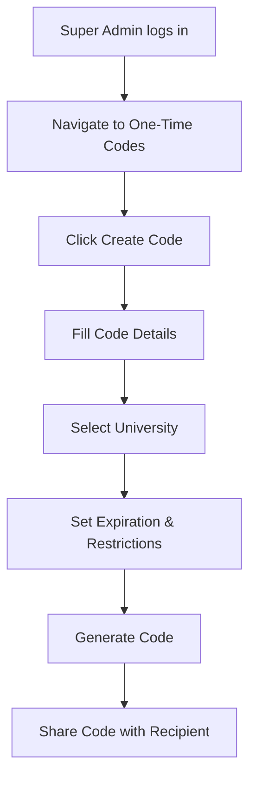
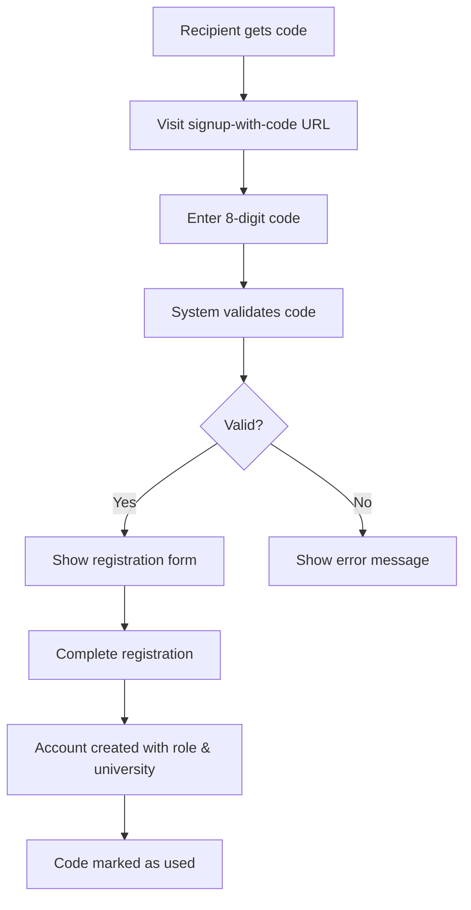

# One-Time Code System Documentation

## Overview

The One-Time Code System allows super administrators to create secure, time-limited codes that enable vendors and admins to sign up for the first time with automatic university assignment and role-based account creation.

## Features

### 🔑 **Core Functionality**
- **Secure Code Generation**: 8-character alphanumeric codes (e.g., `AB3C7X9Z`)
- **Role-Based Creation**: Separate codes for vendor and admin accounts
- **University Linking**: Automatic university assignment during signup
- **Time-Limited**: Configurable expiration (default: 7 days)
- **Usage Control**: Configurable maximum uses per code (default: 1)
- **Email Restrictions**: Optional domain or specific email restrictions

### 🛡️ **Security Features**
- **Auto-Expiration**: Codes automatically expire after set time
- **Usage Tracking**: Monitor who used which code and when
- **Deactivation**: Manual deactivation of codes
- **Email Validation**: Restrict codes to specific emails or domains
- **Audit Trail**: Complete history of code creation and usage

### 📊 **Management Features**
- **Dashboard Integration**: Full management interface in Super Admin dashboard
- **Filtering & Search**: Filter by type, status, university
- **Export Functionality**: Export code lists to CSV
- **Real-time Status**: Live status updates (active, expired, used)
- **Bulk Operations**: Manage multiple codes efficiently

## How It Works

### 1. **Code Creation Process**


### 2. **Code Usage Process**


## API Reference

### Models

#### OneTimeCode
```typescript
interface OneTimeCode {
  id: string;                  // Code ID (the actual code)
  code: string;                // The verification code (8 chars)
  type: 'vendor' | 'admin';    // Account type
  universityId: string;        // University linkage
  universityName: string;      // University name
  createdBy: string;           // Super admin who created it
  createdAt: Timestamp;        // Creation time
  expiresAt: Timestamp;        // Expiration time
  usedAt?: Timestamp;          // Usage time (if used)
  usedBy?: string;             // User who used it
  isActive: boolean;           // Active status
  maxUses: number;             // Maximum uses allowed
  usageCount: number;          // Current usage count
  metadata?: {
    createdByName?: string;
    notes?: string;
    restrictions?: {
      emailDomain?: string;    // Domain restriction
      specificEmail?: string; // Specific email restriction
    };
  };
}
```

#### CreateOneTimeCodeRequest
```typescript
interface CreateOneTimeCodeRequest {
  type: 'vendor' | 'admin';
  universityId: string;
  expiresInHours?: number;     // Default: 168 (7 days)
  maxUses?: number;            // Default: 1
  notes?: string;
  emailDomain?: string;        // Optional domain restriction
  specificEmail?: string;      // Optional email restriction
}
```

### Service Methods

#### Creating Codes
```typescript
// Create a new one-time code
static async createOneTimeCode(
  request: CreateOneTimeCodeRequest, 
  createdBy: string,
  createdByName?: string
): Promise<OneTimeCode>
```

#### Validating Codes
```typescript
// Validate a code before use
static async validateOneTimeCode(
  code: string, 
  email?: string
): Promise<OneTimeCodeValidationResult>
```

#### Using Codes
```typescript
// Mark a code as used
static async useOneTimeCode(
  code: string, 
  usedBy: string
): Promise<void>
```

#### Management Operations
```typescript
// Get all codes
static async getAllOneTimeCodes(): Promise<OneTimeCode[]>

// Get active codes only
static async getActiveOneTimeCodes(): Promise<OneTimeCode[]>

// Get codes by university
static async getOneTimeCodesByUniversity(
  universityId: string
): Promise<OneTimeCode[]>

// Deactivate a code
static async deactivateOneTimeCode(codeId: string): Promise<void>

// Delete a code
static async deleteOneTimeCode(codeId: string): Promise<void>
```

## Usage Instructions

### For Super Admins

#### Creating Codes
1. **Navigate** to Super Admin Dashboard → One-Time Codes
2. **Click** "Create Code" button
3. **Select** account type (Vendor or Admin)
4. **Choose** university from dropdown
5. **Set** expiration time (default: 7 days)
6. **Configure** maximum uses (default: 1)
7. **Add** email restrictions (optional)
8. **Add** notes for reference (optional)
9. **Click** "Create Code"
10. **Copy** the generated 8-character code
11. **Share** the code with the intended recipient

#### Managing Codes
- **View All Codes**: See complete list with status indicators
- **Filter Codes**: By type, status, or university
- **Monitor Usage**: Track which codes have been used
- **Deactivate**: Manually disable codes before expiration
- **Export Data**: Download code lists as CSV
- **Search**: Find specific codes quickly

### For Recipients (Vendors/Admins)

#### Using Codes
1. **Receive** the 8-character code from super admin
2. **Visit** signup URL:
   - English: `{domain}/en/signup-with-code`
   - Arabic: `{domain}/ar/signup-with-code`
3. **Enter** the one-time code
4. **Validate** code (system checks automatically)
5. **Complete** registration form with:
   - Full name
   - Email address (must match restrictions if any)
   - Phone number (optional)
   - Password (min 8 characters)
6. **Submit** form to create account
7. **Account** created automatically with:
   - Assigned role (vendor/admin)
   - Linked university
   - All necessary permissions

## URL Structure

### Signup URLs
- **English**: `https://yourdomain.com/en/signup-with-code`
- **Arabic**: `https://yourdomain.com/ar/signup-with-code`

### With Pre-filled Code
- **English**: `https://yourdomain.com/en/signup-with-code?code=AB3C7X9Z`
- **Arabic**: `https://yourdomain.com/ar/signup-with-code?code=AB3C7X9Z`

### Management URLs
- **English**: `https://yourdomain.com/en/super-admin-dashboard/one-time-codes`
- **Arabic**: `https://yourdomain.com/ar/super-admin-dashboard/one-time-codes`

## Security Considerations

### Code Security
- **Random Generation**: Cryptographically secure random codes
- **No Predictable Patterns**: Codes are completely random
- **Time-Limited**: Automatic expiration prevents long-term exposure
- **Single Use**: Codes can be limited to one-time use
- **Activity Tracking**: Full audit trail of all code operations

### Email Restrictions
- **Domain-based**: Restrict to university email domains
- **Specific Email**: Tie code to exact email address
- **Validation**: Real-time email validation during signup

### Access Control
- **Super Admin Only**: Only super admins can create/manage codes
- **Role-based**: Codes create accounts with specific roles
- **University-scoped**: Automatic university assignment

## Database Structure

### Collections Used
- **`oneTimeCodes`**: Stores all one-time codes
- **`users`**: Stores user accounts created via codes
- **`universities`**: University reference data

### Firestore Security Rules
```javascript
// One-time codes - Super admin only
match /oneTimeCodes/{codeId} {
  allow read, write: if request.auth != null && 
    get(/databases/$(database)/documents/users/$(request.auth.uid)).data.role == 'super-admin';
}

// Public read for code validation during signup
match /oneTimeCodes/{codeId} {
  allow read: if true; // Needed for signup validation
}
```

## Error Handling

### Common Error Scenarios
- **Code Not Found**: Invalid or non-existent code
- **Code Expired**: Past expiration timestamp
- **Code Deactivated**: Manually deactivated by admin
- **Usage Limit Reached**: Exceeded maximum uses
- **Email Restricted**: Email doesn't match restrictions
- **Domain Restricted**: Email domain not allowed

### Error Messages
- User-friendly error messages in both English and Arabic
- Specific error codes for debugging
- Graceful fallback for network issues

## Monitoring & Analytics

### Dashboard Metrics
- **Total Codes Created**: Lifetime count
- **Active Codes**: Currently valid codes
- **Usage Statistics**: Success rates and patterns
- **University Distribution**: Codes per university

### Audit Trails
- **Creation Logs**: Who created which codes when
- **Usage Logs**: Who used codes and when
- **Administrative Actions**: Deactivations and deletions

## Best Practices

### For Super Admins
1. **Use Descriptive Notes**: Add context for each code
2. **Set Appropriate Expiration**: Don't make codes too long-lived
3. **Use Email Restrictions**: Limit codes to intended recipients
4. **Monitor Usage**: Regularly check code status
5. **Clean Up**: Delete or deactivate unused expired codes

### For Recipients
1. **Use Codes Quickly**: Don't wait until expiration
2. **Use Correct Email**: Match any email restrictions
3. **Keep Codes Secure**: Don't share codes with others
4. **Contact Support**: If codes don't work, contact admin

## Troubleshooting

### Common Issues
- **Code Not Working**: Check expiration and usage limits
- **Email Rejected**: Verify email domain restrictions
- **Registration Fails**: Check password requirements
- **Access Denied**: Ensure code is for correct role type

### Debug Steps
1. Check code status in admin dashboard
2. Verify email restrictions
3. Check expiration timestamps
4. Review usage count vs. limits
5. Examine error logs

## Future Enhancements

### Potential Features
- **Bulk Code Generation**: Create multiple codes at once
- **Custom Code Formats**: Allow custom code patterns
- **SMS Integration**: Send codes via SMS
- **Email Integration**: Automated code delivery
- **QR Code Generation**: Generate QR codes for easy sharing
- **Advanced Analytics**: Detailed usage reports
- **Integration APIs**: External system integration

### Technical Improvements
- **Caching**: Cache code validation for performance
- **Rate Limiting**: Prevent brute force attacks
- **Background Jobs**: Automatic cleanup of expired codes
- **Notifications**: Alert super admins of code usage
- **Backup Systems**: Code recovery mechanisms

---

## Quick Reference

### Code Format
- **Length**: 8 characters
- **Characters**: A-Z, 0-9 (uppercase alphanumeric)
- **Example**: `AB3C7X9Z`

### Default Settings
- **Expiration**: 7 days (168 hours)
- **Max Uses**: 1 time
- **Type**: Vendor or Admin
- **Status**: Active when created

### Key URLs
- **English Signup**: `/en/signup-with-code`
- **Arabic Signup**: `/ar/signup-with-code`
- **Management**: `/en/super-admin-dashboard/one-time-codes`

This comprehensive system ensures secure, controlled, and auditable account creation for vendors and admins while maintaining the flexibility needed for different organizational structures and requirements.
