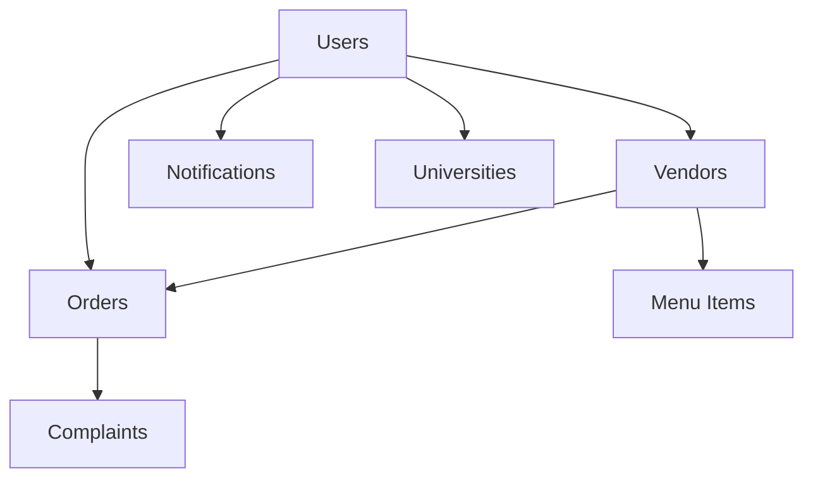

# Campus Bites - Database Architecture

## Overview

Campus Bites is migrating from **Firebase Firestore** to **Appwrite** as its primary NoSQL database. The migration maintains the same architectural decisions while leveraging Appwrite's benefits:

### Current Status: Migration in Progress
- **Legacy System**: Firebase Firestore (existing data preserved)
- **New System**: Appwrite (new backend implementation)
- **Migration Strategy**: Parallel implementation without data migration

### Key Architectural Decisions (Maintained in both systems):

- **Multi-app Architecture**: Customer, Vendor, and Admin apps share a common database
- **Role-based Access**: Users have different roles (student, vendor, admin) with specific permissions
- **University-scoped Data**: Most data is filtered by university to ensure campus-specific operations
- **Real-time Updates**: Leverages real-time capabilities for order tracking and notifications

## Database Systems

### Appwrite (Current Implementation)
- **Endpoint**: Configurable via environment variables
- **Database**: Single database with multiple collections
- **Authentication**: Appwrite Auth with email/password
- **Real-time**: WebSocket-based subscriptions
- **Storage**: Appwrite Storage for file uploads
- **Security**: Collection-level and document-level permissions

### Firebase Firestore (Legacy - Data Preserved)
- **Project**: campusbites-eg
- **Authentication**: Firebase Auth
- **Real-time**: Firestore real-time listeners
- **Storage**: Firebase Storage
- **Security**: Firestore security rules

---

## Appwrite Collections Schema

All collections maintain the same data structure as Firebase with some enhancements:

### Configuration
```typescript
// Environment Variables Required
NEXT_PUBLIC_APPWRITE_ENDPOINT=https://cloud.appwrite.io/v1
NEXT_PUBLIC_APPWRITE_PROJECT_ID=your-project-id
NEXT_PUBLIC_APPWRITE_DATABASE_ID=main
NEXT_PUBLIC_APPWRITE_USERS_COLLECTION_ID=users
NEXT_PUBLIC_APPWRITE_VENDORS_COLLECTION_ID=vendors
NEXT_PUBLIC_APPWRITE_ORDERS_COLLECTION_ID=orders
NEXT_PUBLIC_APPWRITE_UNIVERSITIES_COLLECTION_ID=universities
NEXT_PUBLIC_APPWRITE_COMPLAINTS_COLLECTION_ID=complaints
NEXT_PUBLIC_APPWRITE_NOTIFICATIONS_COLLECTION_ID=notifications
NEXT_PUBLIC_APPWRITE_STORAGE_BUCKET_ID=images
```

---

## Core Collections

### 1. Users Collection (`users`)

Stores all user information across different roles.

```javascript
// Document ID: Firebase Auth UID
{
  "id": "string",                    // Firebase Auth UID
  "fullName": "string",              // User's full name
  "email": "string",                 // University email address
  "universityId": "string",          // Student/Staff ID
  "universityName": "string",        // University name for filtering
  "phoneNumber": "string",           // Contact number
  "isEmailVerified": boolean,        // Email verification status
  "role": "string",                  // "student", "vendor", or "admin"
  "walletBalance": number,           // Digital wallet balance (EGP)
  "profileImageUrl": "string"        // Profile picture URL
}
```

**Key Features:**
- Role-based access control
- University-based segregation
- Digital wallet integration
- Email verification tracking

---

### 2. Vendors Collection (`vendors`)

Contains vendor business information and menu structure.

```javascript
// Document ID: Vendor's Firebase Auth UID
{
  "name": "string",                  // Business name
  "userId": "string",                // Reference to user document
  "universityId": "string",          // University association
  "universityName": "string",        // University name for filtering
  "description": "string",           // Business description
  "imageUrl": "string",              // Vendor logo/image
  "rating": number,                  // Average rating (0-5)
  "reviewCount": number,             // Total number of reviews
  "categories": ["string"],          // Food categories offered
  "isOpen": boolean,                 // Current operational status
  "isApproved": boolean,             // Admin approval status
  "isSuspended": boolean             // Suspension status
}
```

#### Vendor Subcollections

##### 2.1. Menu Subcollection (`vendors/{vendorId}/menu`)

Stores vendor's menu in a nested category structure.

```javascript
// Document ID: Auto-generated (typically one document per vendor)
{
  "categoryName": {
    "Name": "string",                // Display name of category
    "CID": number,                   // Category ID for ordering
    "itemId": {
      "Name": "string",              // Item name
      "Description": "string",       // Item description
      "Price": number,               // Price in EGP
      "ImagePath": "string",         // Firebase Storage path
      "Popularity": number,          // Popularity score for ranking
      "Category": "string",          // Category reference
      "IsAvailable": boolean,        // Availability status
      "CustomizationOptions": {      // Add-ons and modifications
        "optionName": number         // Option name: additional price
      }
    }
  }
}
```

##### 2.2. Vendor Orders Subcollection (`vendors/{vendorId}/orders`)

Vendor-specific view of orders for efficient querying.

```javascript
// Document ID: Order ID (matches main orders collection)
{
  "id": "string",                    // Order ID
  "userId": "string",                // Customer ID
  "vendorId": "string",              // Vendor ID
  "items": [OrderItem],              // Array of ordered items
  "total": number,                   // Total amount
  "status": "string",                // Order status
  "paymentMethod": "string",         // Payment method used
  "createdAt": timestamp             // Order timestamp
}
```

---

### 3. Orders Collection (`orders`)

Main orders collection for global order tracking.

#### Current Schema (Version 1.1 - Enhanced with Categories)
```javascript
// Document ID: Auto-generated
{
  "id": "string",                    // Order ID
  "userId": "string",                // Customer ID
  "vendorId": "string",              // Vendor ID
  "items": [{
    "id": "string",                  // Menu item ID
    "name": "string",                // Item name
    "price": number,                 // Item price
    "quantity": number,              // Quantity ordered
    "note": "string",                // Special instructions
    "customizations": {},            // Selected customizations
    "category": "string"             // 🆕 Food category for analytics
  }],
  "total": number,                   // Total order amount
  "status": "string",                // "pending", "confirmed", "ready", "completed", "cancelled"
  "paymentMethod": "string",         // "Wallet" or "Cash"
  "createdAt": timestamp             // Order creation time
}
```

#### Enhanced Schema (Version 2.0 - Future Implementation)
```javascript
// Document ID: Auto-generated
{
  "id": "string",                    // Order ID
  "userId": "string",                // Customer ID
  "vendorId": "string",              // Vendor ID
  "items": [{
    "id": "string",                  // Menu item ID
    "name": "string",                // Item name
    "price": number,                 // Item price
    "quantity": number,              // Quantity ordered
    "note": "string",                // Special instructions
    "customizations": {}             // Selected customizations
  }],
  "total": number,                   // Total order amount
  "status": "string",                // "pending", "confirmed", "ready", "completed", "cancelled"
  "paymentMethod": "string",         // "Wallet" or "Cash"
  "createdAt": timestamp,            // ✅ Order creation time (already exists)
  "confirmedAt": timestamp,          // 🆕 When vendor confirms order
  "readyAt": timestamp,              // 🆕 When order is ready for pickup
  "completedAt": timestamp,          // 🆕 When order is completed
  "cancelledAt": timestamp,          // 🆕 When order is cancelled (optional)
  "statusHistory": [{               // 🆕 Track all status changes
    "status": "string",              // Status name
    "timestamp": timestamp,          // When status changed
    "updatedBy": "string",           // Who changed the status (vendorId or userId)
    "note": "string"                 // Optional status change note
  }]
}
```

**Migration Benefits:**
- **Accurate Response Times**: Real tracking of vendor confirmation times
- **Performance Analytics**: Precise calculation of preparation times
- **Order Timeline**: Complete audit trail of order progression
- **Better UX**: Real-time status updates with exact timestamps

#### Order Status Flow:
1. **pending** → Initial order state
2. **confirmed** → Vendor accepts order
3. **ready** → Order prepared for pickup
4. **completed** → Order fulfilled
5. **cancelled** → Order cancelled (any stage)

---

### 4. Universities Collection (`universities`)

Reference data for supported universities.

```javascript
// Document ID: University ID
{
  "id": "string",                    // University identifier
  "name": "string",                  // Full university name
  "emailDomain": "string"            // Email domain for validation
}
```

**Supported Universities:**
- Egypt University of Informatics (`students.eui.edu.eg`)
- German University in Cairo (`guc.edu.eg`)

---

### 5. Complaints Collection (`complaints`)

Customer support and dispute management.

```javascript
// Document ID: Auto-generated
{
  "id": "string",                    // Complaint ID
  "userId": "string",                // Customer ID
  "vendorId": "string",              // Vendor ID
  "orderId": "string",               // Related order ID
  "title": "string",                 // Complaint title
  "description": "string",           // Detailed description
  "status": "string",                // "pending", "in_progress", "resolved"
  "createdAt": timestamp,            // Creation time
  "resolvedAt": timestamp,           // Resolution time (optional)
  "resolution": "string",            // Resolution description (optional)
  "adminId": "string"                // Resolving admin ID (optional)
}
```

---

### 6. Notifications Collection (`notifications`)

Push notification management and history.

```javascript
// Document ID: Auto-generated
{
  "id": "string",                    // Notification ID
  "userId": "string",                // Target user ID
  "title": "string",                 // Notification title
  "body": "string",                  // Notification content
  "status": "string",                // Notification status
  "createdAt": timestamp,            // Creation time
  "read": boolean                    // Read status
}
```

---

## Data Relationships

### Primary Relationships



### Key Relationships:

1. **Users ↔ Vendors**: One-to-one (vendor users)
2. **Users ↔ Orders**: One-to-many (customer orders)
3. **Vendors ↔ Orders**: One-to-many (vendor receives orders)
4. **Vendors ↔ Menu**: One-to-many (vendor menu items)
5. **Orders ↔ Complaints**: One-to-one (optional)
6. **Universities ↔ Users**: One-to-many (university students/vendors)

---

## Data Access Patterns

### Query Patterns by Role

#### Student (Customer) Queries:
- Get vendors by university: `vendors.where('universityName', '==', userUniversity).where('isApproved', '==', true)`
- Get user orders: `orders.where('userId', '==', userId).orderBy('createdAt', 'desc')`
- Get vendor menu: `vendors/{vendorId}/menu`

#### Vendor Queries:
- Get vendor orders: `vendors/{vendorId}/orders.orderBy('createdAt', 'desc')`
- Get today's orders: `vendors/{vendorId}/orders.where('createdAt', '>=', todayStart)`
- Update order status: Batch update to both `orders` and `vendors/{vendorId}/orders`

#### Admin Queries:
- Get pending vendors: `vendors.where('isApproved', '==', false)`
- Get all complaints: `complaints.orderBy('createdAt', 'desc')`
- Get users by role: `users.where('role', '==', targetRole)`

---

## Security Rules & Permissions

### Role-based Access Control:

```javascript
// Firestore Security Rules (conceptual)
rules_version = '2';
service cloud.firestore {
  match /databases/{database}/documents {
    // Users can read/write their own data
    match /users/{userId} {
      allow read, write: if request.auth != null && request.auth.uid == userId;
    }
    
    // Vendors can read/write their own vendor data
    match /vendors/{vendorId} {
      allow read: if request.auth != null;
      allow write: if request.auth != null && request.auth.uid == vendorId;
    }
    
    // Orders: users can read their orders, vendors can read/update their orders
    match /orders/{orderId} {
      allow read: if request.auth != null && 
        (resource.data.userId == request.auth.uid || 
         resource.data.vendorId == request.auth.uid);
      allow create: if request.auth != null && request.data.userId == request.auth.uid;
      allow update: if request.auth != null && resource.data.vendorId == request.auth.uid;
    }
  }
}
```

---

## Performance Optimizations

### Indexing Strategy:

1. **Composite Indexes:**
   - `vendors`: `(universityName, isApproved)`
   - `orders`: `(userId, createdAt)`
   - `orders`: `(vendorId, createdAt)`
   - `orders`: `(vendorId, status, createdAt)`

2. **Single Field Indexes:**
   - `users.role`
   - `users.universityName`
   - `vendors.isApproved`
   - `orders.status`

### Data Denormalization:

1. **Order Duplication**: Orders stored in both main collection and vendor subcollection for efficient vendor-specific queries
2. **Menu Flattening**: Menu items embedded within vendor documents for faster menu loading
3. **User Role Caching**: Role information duplicated for quick access control

---

## Scalability Considerations

### Current Architecture Strengths:
- **University Segmentation**: Natural data partitioning by university
- **Role-based Collections**: Efficient queries by user type
- **Subcollection Strategy**: Vendor orders in subcollections for better performance

### Future Scaling Plans:
1. **Horizontal Partitioning**: Split by university regions
2. **Caching Layer**: Redis for frequently accessed menu data
3. **Analytics Collection**: Separate collection for order analytics and reporting
4. **Archive Strategy**: Move completed orders to archive collections

---

## Data Backup & Recovery

### Backup Strategy:
1. **Daily Firestore Exports**: Automated exports to Google Cloud Storage
2. **Point-in-time Recovery**: Firestore's built-in recovery capabilities
3. **Critical Data Replication**: User profiles and order data replicated across regions

### Disaster Recovery:
1. **Multi-region Setup**: Primary and secondary regions configured
2. **Automated Failover**: Application-level failover for critical operations
3. **Data Validation**: Regular integrity checks and validation scripts

---

## Database Migration & Schema Evolution

### Schema Version 2.0 Migration

**Migration Script**: `scripts/migrateOrderTimestamps.js`

This migration adds enhanced timestamp tracking to existing orders for accurate analytics:

#### New Fields Added:
- `confirmedAt`: Timestamp when vendor confirms order
- `readyAt`: Timestamp when order is ready for pickup  
- `completedAt`: Timestamp when order is completed
- `cancelledAt`: Timestamp when order is cancelled
- `statusHistory`: Array tracking all status changes
- `schemaVersion`: Version tracking for future migrations

#### Migration Commands:
```bash
# Dry run to preview migration
npm run migrate:orders:dry-run

# Execute full migration  
npm run migrate:orders

# Rollback if needed
npm run migrate:orders:rollback
```

#### Migration Benefits:
- **Real Response Times**: Accurate vendor confirmation tracking
- **Performance Analytics**: Precise preparation time calculations
- **Complete Audit Trail**: Full order timeline visibility
- **Better UX**: Real-time status updates with exact timestamps

---

## Future Enhancements

### Planned Collections:

1. **Analytics Collection**: Order patterns, popular items, revenue tracking
2. **Reviews Collection**: Customer reviews and ratings for vendors
3. **Promotions Collection**: Discount codes and promotional campaigns
4. **Inventory Collection**: Real-time inventory tracking for menu items
5. **Transactions Collection**: Detailed wallet transaction history

### Integration Points:
- **Payment Gateway**: Fawry/Paymob integration for wallet recharge
- **Analytics Platform**: Export to Google Analytics or custom dashboard
- **Business Intelligence**: Integration with reporting tools for vendor insights

---

*Last Updated: August 8, 2025*
*Database Version: 2.0 (Enhanced Timestamps)*
*Document Maintained by: Campus Bites Development Team*
